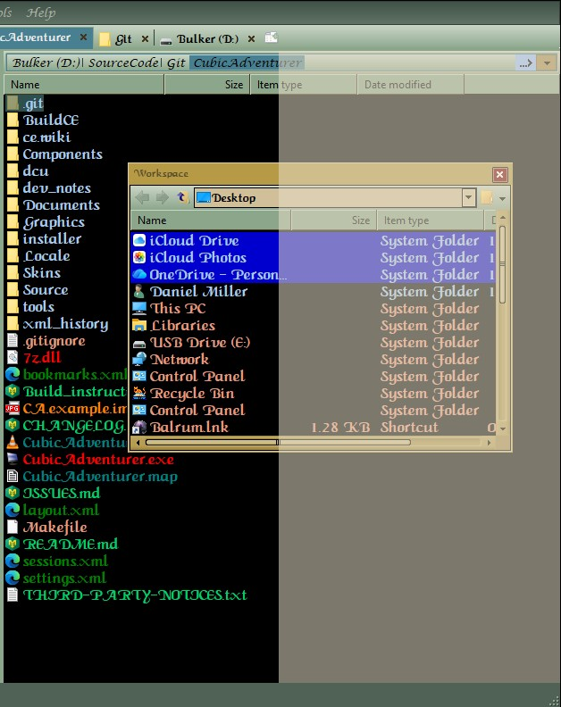

# CubicAdventurer: Tips and Tricks

CubicAdventurer has no tooltips and no built-in help, so this is the closest thing to a manual.
It explains the features that are easy to miss.

- [Bookmarks and Sessions](#bookmarks-and-sessions): get back to where you were
- [Panels at a glance](#panels-at-a-glance) (Ctrl+1 to Ctrl+6)
- [Workspace: a second file list](#workspace-a-second-file-list) (dual-pane layout)
- [The address bar: breadcrumbs or typing](#the-address-bar-breadcrumbs-or-typing)
- [Tabs: options and Undo Tab Close](#tabs-options-and-undo-tab-close)
- [File list options and colors](#file-list-options-and-colors)
- [File Search](#file-search)
- [Toolbars and the Customize dialog](#toolbars-and-the-customize-dialog)
- [Hotkeys](#hotkeys)
- [Commands with no menu item](#commands-with-no-menu-item)
- [The tray icon](#the-tray-icon)
- [Where your settings live](#where-your-settings-live)
- [Starting from the command line](#starting-from-the-command-line)
- [Small things worth knowing](#small-things-worth-knowing)

## Bookmarks and Sessions

Two ways to get back to where you were. **Bookmarks** remember places (folders, files, even
sessions). **Sessions** remember a whole set of open tabs.

### Bookmarks

Open the Bookmarks panel with **Ctrl+2** (or the **Bookmarks** menu). It is a tree of
categories and bookmarks, stored in `bookmarks.xml` in the settings folder.

**Add a category or bookmark**
1. Right-click in the panel and choose **Add Category** to make a folder-like group.
2. Select the category where the new item should go, switch to a file-list tab, then right-click
   in the panel and choose **Add Bookmark**. The folder shown in that tab is bookmarked.
3. **Rename** and **Delete** are on the same menu. Drag items inside the tree to reorder them or
   move them between categories.

**Quick way:** open the **Bookmarks** menu and choose **Bookmark current folder**. The folder
shown in the active tab is added at the top level of the list, and the panel does not have to
be open. (Drag it into a category afterwards if you want it there.) You can also drag a folder's
tab onto the open Bookmarks panel and drop it where you want the bookmark.

**Use a bookmark**
- Double-click a folder bookmark to open it in a **new tab**. A bookmark never replaces the folder
  of the tab you are in. Where the new tab goes and whether it is selected follow
  Tools > Options > Tabs. A single click only selects the bookmark. Right-click >
  **Open in new tab**, Alt+click or a middle-click do the same.
- Double-click a file bookmark to launch the file.

**Open a whole category at once**: select the category, then right-click > **Open All in Tabs**.
Every folder bookmark in it opens in its own tab (file bookmarks are skipped).

**Properties...** shows a bookmark's target. You can change it, browse for another one, or store
it as a relative path.

**Add Session** puts a session in the tree (you pick one from your saved sessions). Opening that
bookmark loads the session.

Other options on the same page: **Auto expand tree** and **Auto collapse tree**.

### Sessions

A session is the set of tabs you have open: each tab's folder and settings, and which tab was
selected. Sessions are stored in `sessions.xml` in the settings folder.

**Start a new session**: **Sessions > New Session** closes all tabs (if they were not part of a
saved session they are first copied to History) and opens a single tab at **This PC**. Open the
folders you want, then use **Sessions > Save...** to give the session a name.

**Update a session once**: **Sessions > Update Current Session** saves the open tabs into the active
session right away. Use it for a one-time change (for example, adding a drive to a session that
does not have **Save changes to this session automatically**).

**Leave a session, keeping the tabs**: **Sessions > Detach from Session**. The tabs stay open but
are no longer part of the session; they are a plain tab set again (and are handled like one at
exit). A session with **Save changes to this session automatically** is brought up to date
first; any other keeps what was saved.

**Save the current tabs**: **Sessions > Save...**, type a name, OK. Using an existing name
overwrites that session. The session is written to disk at once, and it becomes the active
session (the one shown with a check mark in the Sessions menu). Tick **Save changes to this
session automatically** in the same dialog if the session should follow your tabs from now on
(see Manage, below).

**Load a session**: pick it from the **Sessions** menu (saved sessions are listed there) or from
the Sessions toolbar. **Loading closes all current tabs first**, then opens the saved ones.
If the tabs you had open were not part of a saved session, a copy of them is put in **History**
first, so you can get them back from there.

**Sessions > Manage...** lets you delete and rename sessions, change their order by dragging, and
switch **Save changes to this session automatically** for a session. While that session is the
active one, any change to your tabs (a folder, a tab added, closed or moved, the selected tab) is
saved into it within a few seconds, and again when you switch to another session or exit.

**History** (a submenu of **Sessions**) keeps automatic snapshots:
- **Add History Item** takes a snapshot now.
- **Auto Save History** takes one every time you exit. The last 30 are kept.
- **Clear History** deletes them all.

History is for tabs that are *not* part of a saved session. While a saved session is active,
exiting adds nothing to History; the program remembers the session's name instead.

**Start with your tabs back**: Tools > Options > General > **On Startup**:
- **Open default tab**: the normal start.
- **Continue from last time**: if a saved session was active when you closed the program, that
  session is loaded again exactly as saved (with **Save changes to this session automatically**
  off, it returns to the folders you saved, whatever you changed since; with it on, it returns
  to where you left off). Otherwise the tabs you had when you last closed the program are
  restored.
- **Load session**: starts with a saved session of your choice.

Note: a session holds only your open **tabs**.

## Panels at a glance

The View menu turns the side panels on and off. Each has a keyboard shortcut.

| Panel | Shortcut | What it is |
|---|---|---|
| Folders | Ctrl+1 | The folder tree. |
| Bookmarks | Ctrl+2 | Your saved places (see above). |
| Quickview | Ctrl+3 | A preview of the file you have selected. |
| Filters | Ctrl+4 | Type some text to show only the matching names in the file list. |
| Stack | Ctrl+5 | A holding area: drag files into it from several folders, then drag them out to a destination later. |
| Workspace | Ctrl+6 | A second file list (see below). |

Panels can be dragged to other places in the window, or left floating. **View > Panels > Lock
Panels** stops them from moving by accident, and **View > Toolbars > Lock Toolbars** does the same for the toolbars.
If you cannot drag a panel or toolbar, check whether the matching Lock item is ticked.

## Workspace: a second file list

The **Workspace** panel is a second, smaller file browser. It has its own address box, its own
Back, Forward and Up buttons, and its own view style: right-click an empty spot in it to switch
between Large Icons, Details, Thumbnails and so on. Docked beside your main file list, it gives
you a dual-pane file manager, like XTree or Total Commander.

**Set up a dual-pane layout**
1. Turn it on with **View > Workspace** (or Ctrl+6).
2. Make sure **View > Panels > Lock Panels** is not ticked.
3. Drag the Workspace panel by its title bar (or its tab) toward the edge where you want it
   (for example the right side). Watch the mouse pointer, not the panel: as soon as the
   **pointer touches that edge** of the window, a shaded block appears showing where the panel
   will land. Release the mouse button and it snaps into place. This works the same way for
   every dockable panel.

   

   *The shaded area on the right is the drop target: the panel will fill it when you release the mouse.*
4. Browse each pane to a different folder, then drag files from one to the other as you would in
   Windows Explorer (hold Ctrl to copy, Shift to move).

**Browse To** (Ctrl+E) points the Workspace at the folder shown in your current tab, a quick way
to start from the same place.

The layout is remembered when you close the program. To put everything back the way it was
installed, use **View > Restore Default Layout**.

## The address bar: breadcrumbs or typing

The address bar has two modes. In **breadcrumb** mode it shows the path as a row of clickable
parts (for example `This PC > Documents > Projects`): click any part to jump to that folder.
In **typing** mode it is an ordinary text box.

- **To type a path**, click the empty space to the right of the breadcrumbs, or use the toggle
  button. The text is selected, so you can type or paste a path straight away. As you type, it
  suggests matching folder names.
- **Escape** puts the current folder's path back and returns to breadcrumbs.
- When you click in the empty space to type, the bar goes back to breadcrumbs by itself when you
  leave the box. The toggle button, on the other hand, stays in the mode you picked.
- The bar has two small buttons at its right end. One is the toggle just mentioned; the other is
  a **drop-down button** that opens a small folder tree, so you can jump to another folder
  without typing.

## Tabs: options and Undo Tab Close

**Tools > Options > Tabs** controls how tabs behave. The ones people ask about:

- **Open new tab as**: what a new tab shows (a copy of the active tab, the Desktop, or a folder you
  choose with **Custom...**).
- **Reuse already open tabs**: when you open a folder that is already open in a tab, that tab is
  selected instead of opening a second one.
- **Exit program when last tab is closed**: with this off, closing the last tab simply opens a new
  one, so the window is never empty. With it on, closing the last tab exits the program.
- **Fit tabs to labels**: ticked, each tab is only as wide as its name. Cleared, the tabs stretch
  to fill the whole tab bar.
- **Close tab on double click**.

**Undo Tab Close** (Ctrl+Shift+T) reopens the tab you closed last, with its folder. Where the
command appears with a small arrow beside it, the arrow lists the tabs you closed recently so you
can choose one.

## File list options and colors

**Tools > Options > Display > Fileview** has the settings for the main file list. Three are easy
to misread:

- **Use per folder settings**: when ticked, the program remembers how each folder was shown (things
  like its view style, sorting and columns) and restores that the next time you open the folder.
  Cleared, one setting applies everywhere. The memory is kept in `perfolder.dat` in the settings
  folder (see below).
- **Browse Zip Files**: cleared (the default), a `.zip` file is an ordinary file and opening it
  launches whatever program is registered for zip files. Ticked, you browse inside the zip like a
  folder, and zip files also show up as folders in the Folders panel.
- **Remember thumbnails**: saves thumbnails so they do not have to be redrawn every time.
  **Refresh** (F5) rebuilds them.

The **Colors** tab sets text colors for file types, and the **Attributes** tab sets a color for
folder names and background colors for files with the System, Read-only or Hidden attribute.
- **Extension colors:** type a comma separated list of extensions (for example `txt,doc,rtf`), pick
  a color, and choose Bold, Italic or Underline if you want. Tick **Enable background color** to
  give those files a background color as well.
- **Attribute backgrounds win.** A file that is System, Read-only or Hidden always shows its
  attribute color, even if its extension has a background color, so an attribute is never hidden.
  A file with more than one of those attributes uses the **Combined** color.
- Choose **Default** for any of these colors to turn it off.

## File Search

**File Search** (Ctrl+F) opens a search in a new tab. The
location box starts out with the folder shown in the tab you were in, so searching "from here"
needs no typing.

## Toolbars and the Customize dialog

**Tools > Customize...** opens a small window with three tabs.

**Toolbars.** Tick a toolbar to show it, clear the tick to hide it. For the selected toolbar you
can also change its look (large icons, borders, stretch, drag handle).

**Buttons.** This is how you add your own buttons to the toolbars, or remove the ones you do not
use. While this tab is open, the toolbars are in edit mode:
- **Add a button:** drag a command from the list onto a toolbar. The commands are grouped by
  type (Edit, View, Tabs and so on).
- **Remove a button:** drag it off the toolbar.
- **Separators** are the thin divider lines between groups of buttons. Drag one onto a toolbar
  the same way to space your buttons out.

Switch to another tab, or close the window, to leave edit mode.

**Theme.** Pick the look of the program. The same choice is available under **View > Themes**.

## Hotkeys

**Tools > Options > Hotkeys** lists every command with its keyboard shortcut.
1. Click a command in the list. Its current keys appear in the **Hotkeys** box on the right.
2. Click the empty box under **Modify Hotkey** and press the keys you want. The box shows them.
3. **Add** gives the command an extra key. **Replace** swaps the selected key for the new one.
   **Delete** removes the selected key. **Reset to default** puts the original keys back (it takes
   effect after you restart the program).

A command can have more than one hotkey. If the keys you pressed already belong to another
command, you are asked before they are reassigned.

## Commands with no menu item

A few useful commands are not in any menu. You can give them a hotkey (see above) or put them on
a toolbar as a button (see **Customize > Buttons**):
- **Open Command Prompt** opens a command window in the folder shown in the current tab.
- **Empty Recycle Bin** empties the Recycle Bin.

## The tray icon

**Tools > Options > General > Tray Icon** has four check boxes:

- **Show** puts the CubicAdventurer icon in the notification area (the system tray, at the right
  end of the taskbar). The next three work only while **Show** is on.
- **Minimize to tray**: the Minimize button hides the window into the tray instead of the taskbar.
- **Close to tray**: the Close button (X) hides the window into the tray instead of exiting. To
  really exit, use **File > Exit** or the tray menu (below).
- **Start minimized to tray**: the program starts hidden. Click the tray icon to show the window.

**Left-click** the tray icon to bring the window back. **Right-click** it for
a small menu: **Show main window** and **Exit**. Starting CubicAdventurer a second time while it
is hidden in the tray also brings the window back.

If the icon does not appear after a restart, Windows may be keeping it in the overflow area (the
small arrow in the taskbar); you can drag it out from there.

## Where your settings live

Everything the program remembers is kept as small text files in one **settings folder**. With the
installer that folder is `%APPDATA%\CubicAdventurer\` (type that into the address bar of any
Explorer window to open it).

| File | What it holds |
|---|---|
| `settings.xml` | Options pages, window and panel settings |
| `layout.xml` | Where the toolbars and panels are |
| `sessions.xml` | Saved sessions and History |
| `bookmarks.xml` | The Bookmarks tree |
| `perfolder.dat` | The per-folder view memory |

- **When it is saved.** The options and layout are written when the program exits normally
  (**File > Exit**, or the window's Close button when Close to tray is off). Sessions and
  bookmarks are written as soon as you change them. If the program is ended from outside (the
  Task Manager, a crash, a power cut), changes made since it started are lost.
- **Starting fresh.** Close the program, rename a file (for example `layout.xml` to
  `layout.xml.bak`), and start it again: it rebuilds that file from its defaults. This is also
  the way to try a clean start without losing your old settings. **View > Restore Default
  Layout** does the same for panel and toolbar positions without closing the program.
- **Backing up or moving.** Copy the whole settings folder. Files from an older CubicExplorer
  load too, and keys the program does not know are ignored.
- **A portable copy.** Next to `CubicAdventurer.exe` is a small file named `settings.path`; its
  first line names the settings folder. Delete it (or point it at a folder on a USB stick) and the
  program keeps its settings beside the exe instead. Starting the line with `[READONLY]` makes
  the program read the settings but never write them.

## Starting from the command line

You can start CubicAdventurer with a folder name and it opens that folder in a new tab (or, if
the program is already running, hands it to the running window):

- `CubicAdventurer.exe "C:\Some Folder"` opens one tab.
- `CubicAdventurer.exe /n "C:\First" /n "D:\Second"` opens each folder in its own tab.
- `/link "C:\Path\To\Shortcut.lnk"` opens the folder a shortcut points to.

Paths may contain system variables such as `%USERPROFILE%` or `%TEMP%`. The complete list is in
`Documents\CommandLine Switches.rtf`.

## Small things worth knowing

- **Refresh** (F5) reloads the file list and also rebuilds its thumbnails. **Refresh Fileview**
  (Shift+F5) reloads the list without touching the thumbnail cache.
- **Scroll Left** and **Scroll Right** move the tab bar when you have more tabs than fit.
- **Only one window runs at a time.** Starting CubicAdventurer again (from the Start Menu, for
  example) brings the existing window forward instead of opening a second one. To work in
  several places at once, use tabs, sessions and the Workspace panel.
- **Text files** are previewed (their first lines, with accented letters and other Unicode text
  shown correctly) in the **Quickview** panel (Ctrl+3). The file list's Thumbnails view shows only
  an icon for a text file.
- **Unicode file names** (accented letters, Chinese, Japanese and so on) show correctly in the file
  list, even in a font that lacks those characters; the program borrows glyphs from another font.
  Emoji in file names are shown, but some other programs, such as the Windows `dir` command,
  cannot display them.
