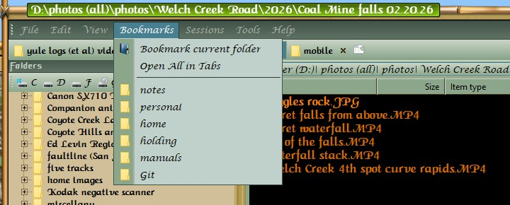

## bookmarks
bookmarks are wonderful helpers...
Think of all the various folders that you more-or-less regularly access.
If you kept every one of those folders in a tab, the tabs would stretch off the screen...
But when you *really* want to reach that one special folder, once a week or once a month,
you really hate scrolling through multiple drives and folders to look for it...

### Bookmarks are the solution
Open a tab, and search around until you find the target folder...  
Then reach up to the menu bar and click `Bookmarks -> Bookmark current folder`

That's it... forevermore, your selected folder will be available, two clicks away, 
in the Bookmarks menu !!

