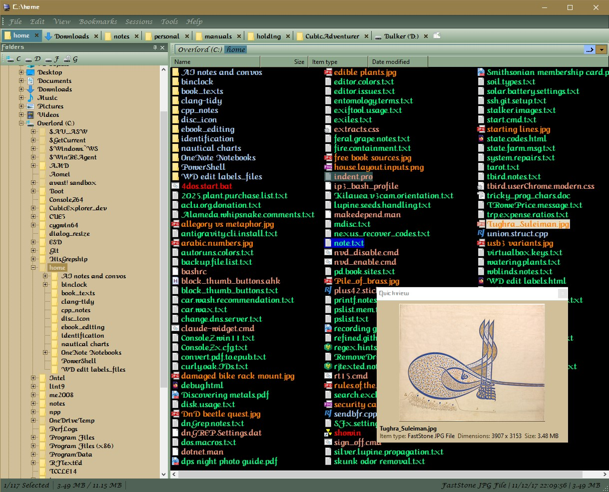

# CubicAdventurer
CubicAdventurer is a revival of the long-abandoned `CubicExplorer` (version 0.96.0.1582), an extremely customizable Windows file manager created by Marko Savolainen.

Copyright 2026 Derell Licht  
Copyright 2006-2012 Marko Savolainen

## Original description (abridged)
CubicExplorer is a file manager aimed for basic and advanced users. Its key features are tabs and bookmarks. It also has sessions, filtering, file previews, search and many more features.

---

Download the latest installer (a zip file) from [Releases](https://github.com/DerellLicht/CubicAdventurer/releases/latest).  
CubicAdventurer is a 32-bit Windows program; it runs on both 32-bit and 64-bit Windows.

See [Changelog](https://github.com/DerellLicht/CubicAdventurer/blob/master/CHANGELOG.md) for the current version and the full revision history.  

## Installing

Unzip the download and run the setup program inside it. It installs for the current user only
(no administrator rights needed), by default under `%LocalAppData%\Programs\CubicAdventurer`.
Your settings are kept separately, in `%APPDATA%\CubicAdventurer\`.
To uninstall, use Windows Settings > Apps.

If you used CubicExplorer before, you can bring your settings along: close CubicAdventurer,
then copy your old `settings.xml`, `layout.xml` and `sessions.xml` into the settings folder.

## License

CubicAdventurer is licensed under the Mozilla Public License 1.1 (MPL 1.1); the original author is Marko Savolainen.  
The bundled `7z.dll` is under the LGPL.  
See the [combined license file](https://github.com/DerellLicht/CubicAdventurer/blob/master/Documents/License.txt) for the full texts.  
The libraries built into the program, and their authors and licenses, are listed in the [third-party notices](https://github.com/DerellLicht/CubicAdventurer/blob/master/Documents/THIRD-PARTY-NOTICES.txt).  

## Documentation

- [Bookmarks and Sessions quick guide](https://github.com/DerellLicht/CubicAdventurer/blob/master/Documents/Bookmarks_and_Sessions.md)
- [Build instructions](https://github.com/DerellLicht/CubicAdventurer/blob/master/Build_instructions.md), if you want to build it yourself or fork it

## NOTE regarding project status

***This is a beta release of this program !!***

I have tested what I can think of, but I'm one user, on one computer.  

This build is a Debug build, which will generate error dialogs in some cases.  
Please report any such errors, and any other issues you observe, on the
[Issues](https://github.com/DerellLicht/CubicAdventurer/issues)
page of this repository.  
Questions, ideas and general discussion are welcome on the
[Discussions](https://github.com/DerellLicht/CubicAdventurer/discussions)
page.  

A useful report includes the text of the error dialog (for example "Range check error"),
what you were doing when it appeared, and your version of Windows.

## Source code locations

One version of the source code is hosted at [vatterspun](https://github.com/vatterspun)'s 
[CubicExplorer](https://github.com/vatterspun/cubicexplorer) repository on GitHub;  
Sadly, it eventually turned out that this version is incomplete, missing all of the tabs from the  
**Tools -> Options -> Display -> Fileview** dialog, among other elements.   

Another, more complete repository was found in the 
[Google Code](https://code.google.com/archive/p/cubicexplorer/source/default/source) 
archive, which is where I found the sources for version 1582.
We ultimately merged the two versions together to create `CubicAdventurer`.

##  Missing or changed elements
Some elements of the original are either removed from this program, or simply are not tested yet.

- English only for now: the original program's language support is not re-enabled yet, and is untested
- The built-in text editor is very rudimentary; there is no built-in support for 
  configuring syntax-highlighting settings, and other aspects are minimal.  
  It remains available (via F7 key, after clicking on a filename), but most users are
  better off dragging a file to their own program editors.
- No support for high-DPI displays
- not tested: treat zip (etc) archives as folders
- not tested: File search, plugins, the media player and the image viewer.
- not tested: non-English (non-ASCII) text in saved settings and in thumbnails of text files.

##  Introducing the development team

[Derell Licht](https://github.com/DerellLicht)
 did the design specification, testing, and guidance on the revisions in this project.

However: [Claude AI](https://claude.ai/new) did *all* of the coding and interpretation of the existing code, 
location of libraries that were compatible with modern Delphi, etc.  
Claude is truly amazing; he implements complex designs in seconds, and they generally 
do exactly what was requested... but debugging and analysis still require a human.
The two of us together, can do almost *anything* !!

